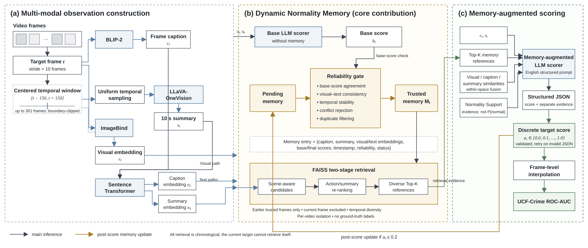

# M³VAD: Multi-modal Large Language Models for Video Anomaly Detection

M³VAD is a training-free, offline video anomaly detection research pipeline built on the original LAVAD baseline. It preserves the baseline scripts while adding target-frame BLIP-2 captions, centered-window LLaVA-OneVision understanding, multi-space retrieval, Dynamic Normality Memory, reliability-gated memory updates, and structured LLM scoring.

The system is offline rather than strictly causal: every target frame may use a centered 10-second window containing earlier and later visual context. Dynamic Memory itself is chronological and video-isolated; a target frame can retrieve only trusted entries created by earlier target frames in the same video.

## Research outcome

**Achieved 81.13% AUC on UCF-Crime vs. 78.32% for zero-shot SOTA LAVAD under identical settings.** This is an absolute improvement of **2.81 AUC percentage points** under the project's matched evaluation protocol.

| Method | Learning setting | UCF-Crime frame-level ROC-AUC |
| --- | --- | ---: |
| LAVAD | Zero-shot, training-free baseline | 78.32% |
| **M³VAD** | Training-free multimodal reasoning with Dynamic Normality Memory | **81.13%** |

### Research context

**Research Intern — NSF REU (Computer Vision)**<br>
**May 2025 – Aug 2025**<br>
Advisor: **Dr. Yu Tian**, Assistant Professor, University of Central Florida

- Developed a training-free multimodal LLM framework for video anomaly detection, combining a hierarchical reasoning pipeline with dynamic memory for frame- and segment-level context.
- Achieved **81.13%** AUC on UCF-Crime vs. **78.32%** for zero-shot SOTA LAVAD under identical settings.

## Architecture



*M³VAD evaluates every tenth target frame using a BLIP-2 frame caption and a uniformly sampled, centered 10-second LLaVA-OneVision context window. A memory-free base score is computed before retrieving previously trusted normality references. The final LLM combines current evidence, retrieved examples, modality-specific similarities, and deterministic Normality Support; only after scoring may the current observation update the per-video Memory Bank.*

## Core technical contribution: Dynamic Normality Memory

The [`src/memory/`](src/memory/) package is the **technical core of M³VAD**. It is deliberately isolated from `llm_anomaly_scorer.py` so that memory representation, retrieval, reliability control, and persistence remain independently testable and can be enabled or disabled for ablation studies. The Memory Bank is not a static prompt history: it is a structured, chronological, per-video normality model built online during offline video inference.

Its main responsibilities are:

- **Bound multimodal entries:** each memory item keeps the BLIP-2 frame caption and corresponding LLaVA-OneVision 10-second summary together with visual, caption, and summary embeddings, scores, timestamps, status, and reliability metadata.
- **Per-video chronological isolation:** every video starts with an empty bank, can retrieve only earlier trusted observations from that same video, and updates memory only after the current frame has been scored. Ground-truth anomaly labels are never used for admission.
- **Contamination resistance:** Robust mode stages low-score observations in Pending Memory and promotes them only after checking the memory-free base score, visual–text agreement, local score stability, evidence conflicts, and near-duplicate status.
- **Two-stage retrieval:** FAISS first finds scene-compatible candidates; caption, action, temporal-summary, and local-video evidence then re-rank candidates, followed by temporal deduplication for a diverse Top-K set.
- **Normality Support:** a deterministic 0–1 evidence-strength measure combines multimodal similarity, cross-modal agreement, memory coverage, and input reliability. It is intentionally **not** presented as a calibrated `P(normal)`.
- **Capacity and persistence:** representative normal patterns are retained under a configurable capacity limit, while deterministic IDs, metadata checks, embeddings, and FAISS indexes support safe resume without duplicate insertion.
- **Ablation-ready policies:** Legacy mode reproduces direct admission when the final score is at most `0.2`; Robust mode adds Pending/Trusted states and reliability gates while preserving the training-free setting.

## System flow

```text
target frame t (every 10 frames)
    ├── BLIP-2 frame caption
    ├── [t - 5 s, t + 5 s] bounded video window
    │       └── uniform temporal sampling → LLaVA-OneVision summary
    ├── ImageBind target/clip visual representation
    ├── Sentence Transformer caption and summary representations
    ├── base LLM anomaly score (without Dynamic Memory)
    ├── trusted-memory retrieval from earlier frames only
    │       ├── scene-aware visual candidate retrieval (FAISS)
    │       ├── action-aware caption/summary re-ranking
    │       └── temporal diversity filtering
    ├── deterministic Normality Support (not a calibrated probability)
    ├── memory-augmented LLM anomaly score
    └── post-score Legacy or Robust Memory update
```

Target-frame anomaly scores are restricted to:

```text
0.0, 0.1, 0.2, 0.3, 0.4, 0.5, 0.6, 0.7, 0.8, 0.9, 1.0
```

Discrete target scores and linearly interpolated frame-level scores are saved separately.

## Code organization

```text
src/
├── models/
│   ├── image_captioner.py                 # preserved BLIP-2 captioning
│   ├── llm_anomaly_scorer.py              # preserved baseline scorer
│   └── llava_onevision_summarizer.py      # centered-window video MLLM
├── memory/
│   ├── memory_entry.py                    # bound caption/summary/embedding entry
│   ├── memory_bank.py                     # video-isolated bank and capacity control
│   ├── multimodal_encoder.py              # ImageBind + Sentence Transformer
│   ├── similarity.py                      # within-space cosine and fusion
│   ├── retriever.py                       # scene-first, action-aware Top-K retrieval
│   ├── normality_support.py               # bounded evidence-support metric
│   ├── update_policy.py                   # Legacy and Robust admission policies
│   └── persistence.py                     # metadata, embeddings, and FAISS persistence
├── scoring/
│   ├── backends.py                        # original Llama 2 / HF chat adapters
│   ├── score_utils.py                     # discrete validation and interpolation
│   └── structured_scorer.py               # JSON validation and retry
├── prompts/
│   ├── m3vad_system.txt                   # English system prompt
│   └── m3vad_user.txt                     # English structured-output prompt
├── pipeline/m3vad_pipeline.py             # experiments B–E
├── evaluate_m3vad.py                      # frame-level ROC-AUC and PR-AUC
└── config.py                              # typed ablation configuration
```

## Experiments

| Experiment | OneVision | Memory | Retrieval | Update policy |
| --- | --- | --- | --- | --- |
| A | No | No | Original baseline | Original baseline |
| B | Yes | No | None | None |
| C | Yes | Yes | Caption + summary only | Legacy (`score <= 0.2`) |
| D | Yes | Yes | Visual + caption + summary | Legacy (`score <= 0.2`) |
| E | Yes | Yes | Visual + caption + summary | Robust reliability gate |

Configuration files are in [`configs/`](configs). Experiment A uses the preserved original scripts `scripts/01_caption.sh` through `scripts/07_eval.sh`. Experiments B–E use `src.pipeline.m3vad_pipeline`.

Robust mode first creates a Pending entry. It becomes Trusted only when the base score also passes, ImageBind visual-text alignment is adequate, recent scores are stable, no explicit evidence conflict exists, and the entry is not a near-duplicate. Ground-truth anomaly labels are never used for memory updates.

## Environment

The original environment remains in `requirements.txt`. The new pipeline uses a modern Transformers release required by LLaVA-OneVision:

```bash
conda create --name mllm-vad python=3.10
conda activate mllm-vad
pip install -r requirements-m3vad.txt
pip install -e libs/ImageBind
```

Python 3.10 or 3.11 is recommended for CUDA compatibility. The default OneVision checkpoint is `llava-hf/llava-onevision-qwen2-7b-ov-hf`. It is large; use the 0.5B checkpoint for development or enable `load_in_4bit` on a supported CUDA/Linux setup. Flash Attention and bitsandbytes are optional because their installability depends on the local GPU toolchain.

## Run M³VAD

First generate BLIP-2 captions at the required target interval:

```bash
python -m src.models.image_captioner \
  --root_path /data/ucf_crime/frames \
  --annotationfile_path /data/ucf_crime/annotations/test.txt \
  --batch_size 16 \
  --frame_interval 10 \
  --pretrained_model_name Salesforce/blip2-opt-6.7b-coco \
  --output_dir /data/ucf_crime/captions/m3vad_blip2
```

Run the recommended Robust Memory experiment with a Hugging Face instruction-tuned text LLM:

```bash
python -m src.pipeline.m3vad_pipeline \
  --config configs/experiment_e_robust_memory.json \
  --root_path /data/ucf_crime/frames \
  --annotationfile_path /data/ucf_crime/annotations/test.txt \
  --captions_dir /data/ucf_crime/captions/m3vad_blip2 \
  --video_dir /data/ucf_crime/videos \
  --output_dir /data/ucf_crime/m3vad/experiment_e \
  --llm_backend transformers \
  --llm_model YOUR_INSTRUCTION_TUNED_MODEL
```

`--video_dir` lets the pipeline read the real source FPS with OpenCV. If it differs from 30 FPS, the 5-second radius is converted to the correct frame count and a warning is recorded. Without source videos, the configured 30 FPS is used.

To reuse precomputed OneVision summaries, add:

```bash
--summaries_dir /data/ucf_crime/onevision_summaries
```

For a dependency-light integration smoke run, use both precomputed summaries and `--mock_models`. Mock outputs must never be reported as research results.

## Outputs

For each video, the pipeline writes:

- `records/<video>.json`: Caption, summary, base/final scores, reasoning, similarities, Normality Support, retrieved entries, reliability metrics, update decision, memory counts, model-call counts, and latency.
- `target_scores/<video>.json`: original discrete base and final target-frame scores.
- `frame_scores/<video>.json`: linearly interpolated frame-level scores.
- `memory/<video>/`: entry metadata, embeddings, and FAISS indexes when FAISS is installed.
- `onevision_cache/<video>.json`: resumable summaries keyed by target frame and sampling metadata.

Memory IDs are deterministic per `(video_id, frame_index)`, so retries do not create duplicate entries. Persistence validates metadata/embedding IDs and FAISS vector counts before resuming.

## UCF-Crime evaluation

```bash
python -m src.evaluate_m3vad \
  --root_path /data/ucf_crime/frames \
  --annotationfile_path /data/ucf_crime/annotations/test.txt \
  --temporal_annotation_file /data/ucf_crime/annotations/Temporal_Anomaly_Annotation_for_Testing_Videos.txt \
  --frame_scores_dir /data/ucf_crime/m3vad/experiment_e/frame_scores \
  --output_path /data/ucf_crime/m3vad/experiment_e/metrics.json \
  --normal_label 0
```

Do not tune retrieval weights, reliability thresholds, or score calibration on the final UCF-Crime test labels. `normality_support` is deliberately named as evidence support rather than `P(normal)`; probability calibration would require a separate validation set.

## Tests

The test suite uses mock features and does not load large models:

```bash
python -m unittest discover -s tests -v
```

It covers empty and undersized Memory, temporal boundaries, the `0.2` admission boundary, invalid JSON and scores, duplicate filtering, index/metadata mismatch, save/load, self-retrieval prevention, idempotent retries, cross-video isolation, temporal diversity, interpolation, and a lightweight end-to-end pipeline run.

## Attribution

The preserved baseline originates from:

```bibtex
@inproceedings{zanella2024harnessing,
  title={Harnessing Large Language Models for Training-free Video Anomaly Detection},
  author={Zanella, Luca and Menapace, Willi and Mancini, Massimiliano and Wang, Yiming and Ricci, Elisa},
  booktitle={Proceedings of the IEEE/CVF Conference on Computer Vision and Pattern Recognition},
  pages={18527--18536},
  year={2024}
}
```
